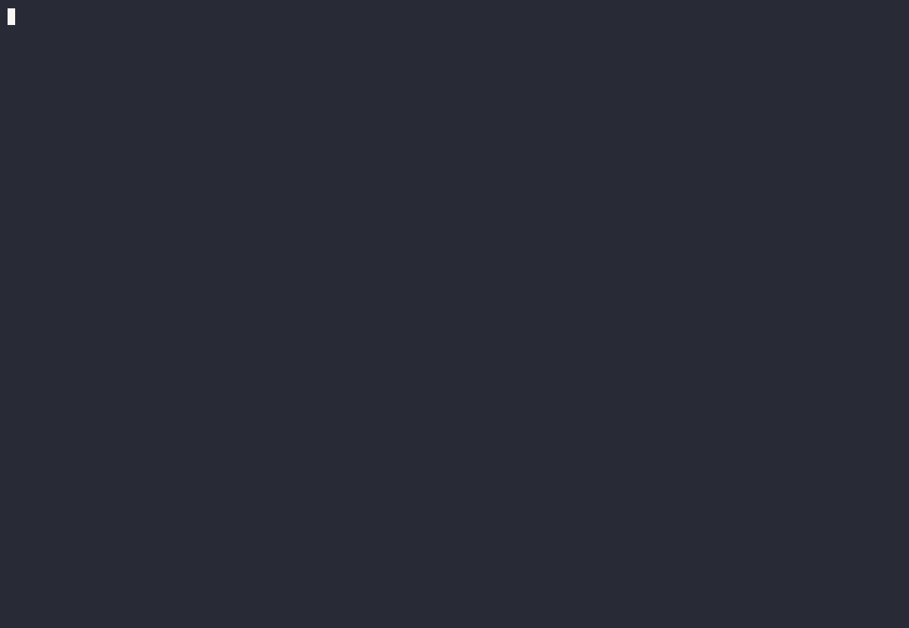
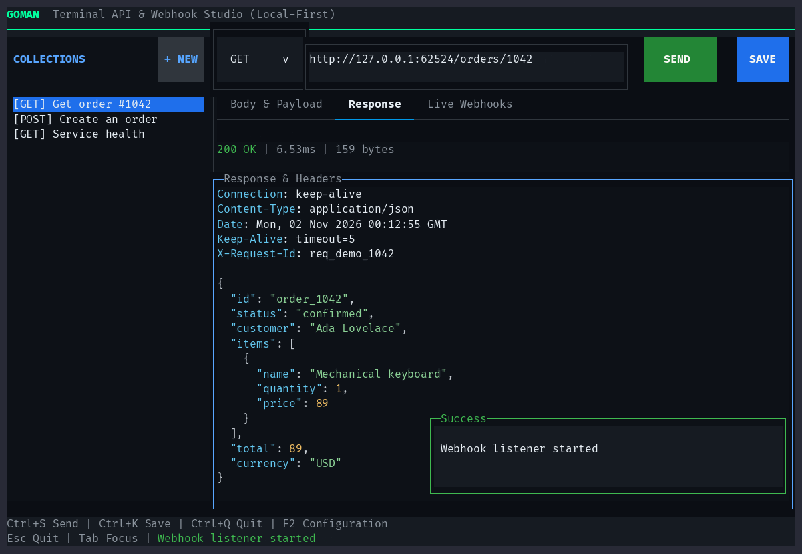
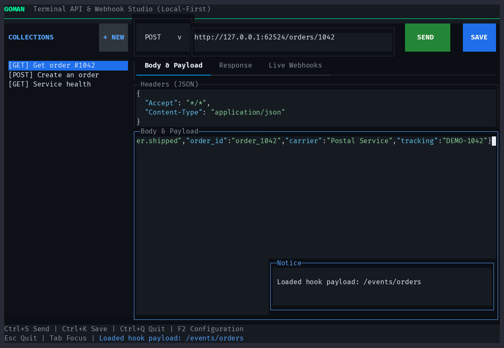

# goman

An HTTP client and webhook inspector for your terminal, written in Go. Send requests, inspect responses, and keep collections in your project directory. No account or hosted service needed.

[Install a release](#installation) or [build from source](#build-and-run).

## Demo

[](docs/media/goman.cast)

[Download the asciinema recording](docs/media/goman.cast), or play it from this checkout with `asciinema play docs/media/goman.cast`. The demo uses a local shop API and sample data.

## Screenshots

HTTP response with status, headers, and a formatted JSON body:



A captured order-shipped webhook, ready to load into the request editor:



## What It Does

- Edit request URLs, methods, JSON headers, and bodies. The method menu offers GET, POST, PUT, PATCH, and DELETE.
- Inspect status codes, response headers, timing, and size, with syntax highlighting for JSON, XML/HTML, and YAML.
- Save requests as local YAML and JSON collections.
- Capture webhooks and load them into the editor for replay.
- Navigate by keyboard, scroll and select text with the mouse, or copy a field to the clipboard.

Shortcuts can be changed for the current session. Actions show brief notifications, and quitting asks for confirmation.

## Build and Run

Building requires Go 1.26 or newer. To use goman, you'll need a terminal at least 80 columns wide and 22 rows tall. The terminal UI library is bundled in `internal/gocui`; you don't need a lazygit checkout or any local module replacements.


From the repository root:

```sh
go run .
```

Build a standalone executable:

```sh
go build -o goman .
./goman
```

On Windows, build with `go build -o goman.exe .`, then run `goman.exe`. Once built, goman doesn't need Go or the source code to run. The old Python application and its tools are no longer included.

Go downloads dependencies listed in `go.mod` and `go.sum`. The bundled gocui code includes the mouse, editing, rendering, and simulation-screen changes used by goman; see its [provenance notes](internal/gocui/UPSTREAM.md).

## Options

```sh
./goman --workspace /path/to/project
./goman --webhook-address 127.0.0.1:9098 --timeout 30s
./goman --insecure
./goman --version
```

| Option | Default | Meaning |
| --- | --- | --- |
| `--workspace` | Current directory | Where to store collections |
| `--webhook-address` | `127.0.0.1:9090` | Address to use when you start the receiver |
| `--timeout` | `15s` | Request timeout; must be positive |
| `--insecure` | Off | Skip TLS certificate verification |
| `--version` | Off | Print the version and exit |

TLS verification is on by default. Use `--insecure` only for trusted development endpoints.

The webhook receiver starts offline and has no authentication or signature verification. Binding it to a non-loopback address makes it reachable from other hosts.

## Controls

| Key | Action |
| --- | --- |
| `Ctrl+S` | Send the request |
| `Ctrl+K` | Save the current request |
| `Ctrl+N` | Start a new request |
| `Ctrl+W` | Start or stop the webhook receiver |
| `Escape` / `Ctrl+Q` | Open quit confirmation |
| `F2` | Change shortcuts |
| `Tab` / `Shift+Tab` | Move focus |
| `Enter` | Activate a control or load the selected request |
| `Ctrl+[` / `Ctrl+]` | Previous / next tab, if your terminal reports distinct Ctrl events |
| `Alt+1` / `Alt+2` / `Alt+3` | Body / Response / Live Webhooks |
| `Ctrl+G` | Select all in the focused field |
| `Ctrl+Shift+A` | Select all, if your terminal reports Shift separately |
| `Ctrl+C` | Copy selected text |
| `Ctrl+A` | Move to the beginning of the line in an editor |

Buttons and tabs also work with the mouse. Open the method menu with a click, Enter, or Down. Choose with the arrows or scroll wheel, then press Enter or click to select. Clicking outside closes the menu without activating anything underneath.

Scrolling affects the field under the pointer. Drag to select text within a field; typing replaces the selection, and Backspace or Delete removes it. Selections never include neighboring panes, borders, or labels. In a read-only field, Select All selects only the displayed preview.

Escape opens quit confirmation even from an editor or the method menu. Press Enter to quit, or Escape again to cancel. You can also click Cancel. Other actions are blocked while a dialog is open.

### Terminal Compatibility

On some macOS keyboards, use Fn+F2. Alt-number shortcuts depend on your terminal settings.

Older terminals report Ctrl+[ as Escape, which opens quit confirmation. If that happens, use F2 to assign a different Previous tab shortcut. Likewise, some terminals report Ctrl+Shift+A as Ctrl+A; Ctrl+G is the reliable Select All shortcut. Cmd+A usually belongs to the terminal app. You can configure your terminal to send Ctrl+G (`0x07`) instead.

Clipboard access, fonts, cell sizes, and modifier keys depend on your terminal and operating system.

### Changing Shortcuts

Press F2, choose an action with the arrows, wheel, or mouse, then press Enter to record a new key. Modified character keys and F1-F12 are supported. Conflicts are rejected; Escape, Tab, Shift+Tab, Enter, and Ctrl+A are reserved.

Tab moves between the list, Reset, Apply, and Cancel. Apply saves your changes for this session; Cancel discards them. Reset puts the defaults into the draft, so you still need to choose Apply. Escape stops recording or closes the dialog.

Assigning a new key removes that action's old aliases. Normal typing and native editor navigation aren't remapped.

## Collections

Collections are stored under `--workspace` in `.goman/collections.yaml` and `.goman/collections.json`. YAML is read first; if it isn't valid, goman tries JSON. Empty collections stay empty. If neither file can be read successfully, goman reports an error instead of replacing your data with examples.

Save appends the current request to the first collection. Each file is replaced atomically with private permissions, but saving the pair isn't a single transaction. Don't run two instances that write to the same workspace. Collections can contain credentials, so review them before adding them to version control.

### Importing Ghostman Collections

If neither goman collection file exists, goman looks for `.ghostman` collections in the same workspace and imports them into `.goman`. It leaves the originals alone and preserves names, URLs, headers, and payloads exactly, including old product names in your data.

Existing `.goman` files take precedence, even if they're empty or invalid. New saves go only to `.goman`; later edits to `.ghostman` aren't synced. If no collection files exist in either location, goman creates three example requests.

## Webhooks

Start the receiver with Ctrl+W, then send it a request:

```sh
curl -X POST http://127.0.0.1:9090/webhook \
  -H 'Content-Type: application/json' \
  -d '{"event":"example","value":42}'
```

Each capture shows a one-line body preview. Use the keyboard or scroll wheel to select a capture for inspection. Click its row or press Enter to load it into the editor. Borders and empty rows do nothing.

Loading a capture copies its method, raw body, and Content-Type and Accept headers. Your destination URL stays unchanged, and nothing is sent until you choose Send.

The receiver replies with `{"status":"ok","source":"goman"}`. Update clients that depend on the old source value. Captures are kept in memory and disappear when you quit.

## Request Behavior

GET and HEAD requests omit the editor body. Other methods send it. Methods loaded from collections or webhooks, including OPTIONS and custom methods, are kept exactly as stored until you select another method. Valid JSON gets a Content-Type header automatically if you haven't set one.

Redirects follow Go's standard HTTP behavior. HTTP error responses can still be inspected; network failures show an error. Setting a Host header changes the HTTP host without changing the connection destination. The default User-Agent is `goman/0.1.0`, unless you've set your own.

## Limits

| Item | Limit |
| --- | --- |
| Response or incoming webhook body | 4 MiB |
| Webhook history | 200 captures or 8 MiB of raw and formatted body text |
| Displayed body preview | 128 KiB, followed by a truncation marker |
| Syntax highlighting | First 64 KiB; stored values stay unchanged |
| Webhook list preview | Reads up to 256 bytes; shows up to 40 grapheme clusters |

JSON formatting checks a conservative 4 MiB output budget before adding indentation. If the result would be too large, goman shows the original JSON.

Status labels are green below HTTP 400 and red for errors. Notifications disappear after two seconds or when clicked. They don't take focus, hide request progress, or appear over dialogs and the method menu.

Bracketed paste inserts text without triggering Send or other shortcuts. If the terminal becomes too small, dialogs hide and return when there's room. Quit confirmation still works from the keyboard.

## Development

```sh
go test -race ./...
go vet ./...
go build ./...
```

The test suite covers the HTTP client, saved collections and migration, plus terminal interactions such as selection, dialogs, shortcuts, and notifications. It also runs the bundled gocui tests.

### Refreshing Demo Media

On macOS or Linux, install Go, Node.js 22 or newer, Expect, curl, asciinema 3, agg 1.9 or newer, and FFmpeg. From the repository root, run:

```sh
node scripts/record-demo.mjs
```

The script builds goman, starts a loopback-only sample API, and drives the app in a 120-column by 36-row terminal. It overwrites the recording, GIF preview, and two PNG screenshots in `docs/media`. Collections live in a temporary workspace that is removed afterward; your own `.goman` data isn't used. Fonts can change the rendered appearance between machines.

## Credits and License

goman is a Go rewrite of [Ghostman](https://github.com/4yk5/ghostman) by [4yk5](https://github.com/4yk5). The original application's workflow and visual design come from that project.

The terminal UI uses the customized [gocui](https://github.com/jesseduffield/gocui) code from [lazygit](https://github.com/jesseduffield/lazygit), included in this repository. It doesn't depend on the lazygit module. See the [gocui provenance notes](internal/gocui/UPSTREAM.md) for its authors and local changes. Syntax highlighting uses [Chroma](https://github.com/alecthomas/chroma).

goman uses the [MIT License](LICENSE) and keeps the original `Copyright (c) 2026 4yk5` notice. The bundled gocui code uses the [BSD-3-Clause license](internal/gocui/LICENSE). Binary distributions must include both notices.

## Installation

Download a build from [GitHub Releases](https://github.com/shoobyban/goman/releases). macOS, Linux, and Windows builds are available for amd64 and arm64. Unix archives use `.tar.gz`; Windows archives use `.zip`. Unpack the archive and put the executable on your PATH. Both license notices are included.

Releases also include Debian packages and a Homebrew cask. Use `checksums.txt` to verify the binary archives and Debian packages. The examples below require a published `v0.1.0` release.

### Debian and Ubuntu

Download the `.deb` for your architecture, then install it with APT to resolve the CA-certificate dependency:

```sh
sudo apt install ./goman_0.1.0_linux_amd64.deb
```

On arm64, use the `linux_arm64.deb` file instead. If dependencies are already installed, you can use `sudo dpkg -i ./goman_0.1.0_linux_amd64.deb`.

The package installs `/usr/bin/goman`. Installing or removing it leaves your workspace data alone.

### Homebrew

There isn't a hosted tap yet. Create a local tap once, then download the release's `goman.rb` cask into it:

```sh
brew tap-new goman/releases
mkdir -p "$(brew --repository goman/releases)/Casks"
curl --fail --location https://github.com/shoobyban/goman/releases/download/v0.1.0/goman.rb \
  --output "$(brew --repository goman/releases)/Casks/goman.rb"
brew install --cask goman/releases/goman
```

The cask chooses the archive for your architecture and checks its checksum. It links the binary without changing workspace data.

To upgrade, download the new tag's `goman.rb` to the same location, then run `brew upgrade --cask goman/releases/goman`.

## Publishing a Release

Commit and push the changes first, then tag the commit:

```sh
git tag v0.1.0
git push origin v0.1.0
```

CI checks formatting, runs vet and race tests, and builds the app on pull requests and pushes to `main`. A version-tag push runs those checks before GoReleaser publishes six binary archives, two Debian packages, the Homebrew cask, and checksums.

Only the publishing job has repository write permission. It uses the built-in `GITHUB_TOKEN`; no extra secret is needed. The cask is attached to the release, not pushed to a tap.

Release builds take their `--version` value from the tag. Local builds default to `0.1.0`. Generated files go in `dist`, which is ignored by Git.
